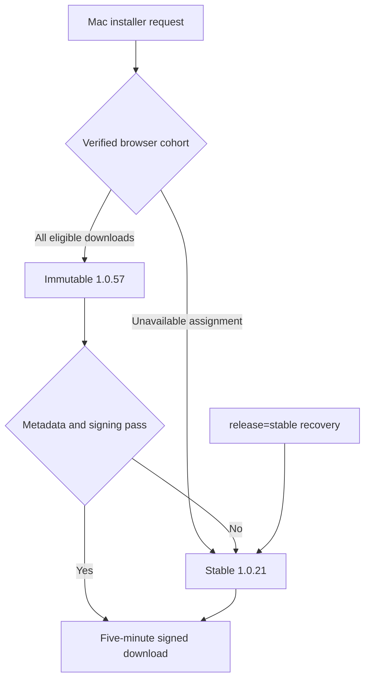

# Mac installer download pilot

## Approved scope

On October 29, 2026, Alex explicitly selected **1% of Mac installer downloads**
for the qualified standard 1.0.57 artifact. This supersedes the immediate
two-person private-link handoff, not the separate native-updater qualification.
The original 1% pilot went live at 2026-10-29T20:01:49Z from Website commit
`96e84a8ae818bbdc618bb23c6bcc46c42a715463`.

On November 2, Alex explicitly approved increasing this installer pilot to
**10%** after reviewing the limited signal: 29 retained successful installer
redirects, all baseline, and no independent 1.0.57 customer in observed telemetry.
Earlier launch logs were no longer retained. This is an owner-approved expansion
to collect signal, not a claim that external installation or updater GA passed.
The candidate bytes, baseline binding and rollout identity remain unchanged, so
every existing 1% member stays selected. Activation requires the same pushed main
SHA in the Git-linked website and Linux API plus live readback.

Later on November 2, Alex requested 100%. That change was paused before edits
when he asked whether this installer included the automatic updater. After the
manual/automatic distinction was clarified, he requested deployment because the
website still served 1.0.21. This authorizes completing **100% of normal Mac
installer downloads** with the same immutable standard 1.0.57 artifact.

At 100%, every valid existing or newly server-issued acquisition identity selects
1.0.57, including browsers previously in the baseline cohort. The existing
30-day cookie, rollout identity and fallback remain unchanged; no IP/device
fingerprint is used. The original rollout changed installer delivery only. The package does not
install the native automatic updater, and no customer-beta/GA proof is inferred
for that separate service.
The 1.0.57 qualification host was macOS 26.6.2 arm64 / Premiere 26.5.2; it does
not establish Intel or other host/OS compatibility. Generic browser user agents
cannot reliably distinguish Apple Silicon from Intel. This pilot includes Mac
installer traffic rather than claiming an architecture filter.

## Routing and recovery

`api/download.ts` selects the candidate only for the normal Mac stable handler.
The existing server-verified acquisition token and a versioned HMAC context
produce an independent deterministic cohort. The selector is bound to the
baseline version **and** hash; a later stable release disables this pilot until
deliberately rebound. No identity is added to download URLs or headers, and no
acquisition record is rewritten. Existing acquisition/referral writes still
occur only after a successful GET redirect. Assignment is not receipt, payment,
installation, or entitlement evidence.

GET persists a newly issued signed acquisition cookie. HEAD without a valid
cookie reports stable without assigning or recording a new identity. A
cookie-bearing HEAD reports the corresponding artifact. Responses vary by
Cookie and are private/no-cache (HEAD/304) or no-store (302). Version, hash and
cohort headers contain no identity. A query or unsigned header cannot force a
pilot assignment; `https://sidestream.tv/api/download?release=stable` always
selects stable for recovery, including an already-selected pilot browser.

Missing/invalid configuration, missing assignment authority or a changed
baseline selects stable. Candidate metadata/signing failures retry the existing
validated stable artifact; a broken stable path still returns its existing
failure instead of serving unverified bytes. Disabled/zero/invalid pilots are
absent from the artifact authorizer allowlist. The signed five-minute byte URLs
retain existing path, expiry and range-security checks.

### Existing-client update notice

On November 5, Alex requested in-app notification for the available manual
1.0.57 release. `notifyExistingClients: true` explicitly selects that candidate
for the Mac `/api/releases/latest` response as channel `stable` at 100% notice
eligibility. Selection requires enabled 100% installer delivery plus the exact
baseline version/hash binding. Missing, false, invalid, disabled, reduced or
mismatched rollout settings retain the validated baseline update response.
Windows never reads this optional Mac notice configuration.

The raw candidate retains `rolloutPercent: 0`; only the notice response receives
100%. The stored 1.0.21 manifest and `?release=stable` recovery download stay
unchanged. Existing older Mac clients show their existing update banner after
their next scheduled check, normally within 12 hours while the panel is running.
Install opens the normal manual installer URL. Notification availability does
not prove every user saw it or installed it. Turning the flag off stops new
notice responses; client caches may retain a notice until their next check.

Paid Mac remains 1.0.17. Windows, the independently published AE installer,
checkout, account/license controls and native Production updater HOLD are not
notice inputs. There is no automatic installation in this package.

## Immutable candidate

- Source: FlowState `4d26ee90e7879333e5a9726c9642eb9cf69504ab`.
- File: `Sidestream-1.0.57-Mac-Installer.dmg`, 227078245 bytes.
- SHA-256: `d8c91d5c6aa2ad3dd882926fd2a6112208ac39a7ec438ba77de5c2ba6f81aebe`.
- Server pathname: `sidestream/manual-beta/1.0.57/Sidestream-1.0.57-Mac-Installer.dmg`.
- Apple Accepted job: `3afd5cdd-8d09-4801-b849-441306f325f9`.
- Evidence: `sidestream-production-release-20261012/qualification/manual-beta-20261022-01`,
  including `repeat-20261026-01/controlled-media-and-relaunch.json`.

The standard installer passed signatures/stapling, expanded ownership/modes,
exact installed bytes, supported Restore, first/repeat installation, preserved
account/history data, real Premiere root/bridge/Pro verification, controlled
video/audio downloads/imports and normal relaunch on the recorded Mac. Two
audio-preview attempts failed with a format error while the subsequent WAV
download/import/Source playback checks passed. No clean independent tester or
generic paid-first/automatic-update qualification is inferred from these checks.
Issued installer bytes and version must never be modified or reused.

## Deployment and live proof

1. Upload through `scripts/upload-hetzner-artifact.mjs`; independently verify
   remote immutable size/hash before activating the config. Preserve 1.0.21.
2. Run targeted routing/delivery tests, `npm run build:hetzner-api`, entitlement
   and frontend build checks. Follow canonical main and Production-source rules.
3. Publish the exact main commit through Git integration, then deploy that same
   SHA to the Linux API as `sidestream-dev`; preserve existing runtime secrets
   and the independent AE and paid configuration. Require healthy same-SHA
   readback before declaring activation.
4. Verify stable and selected-cookie HEAD/GET, repeat assignment, stable
   recovery, Range and full candidate SHA through the public response. Operator
   fixtures must not create fake installs/health/entitlement or be counted as
   customer adoption. Recheck update/paid manifests and native updater HOLD.

## Observation and stop

`[sidestream mac download cohort]` logs only rollout id, selected version and
stable/pilot for successful GET redirects that are not recognized scanners.
These count requests, not unique people, completed transfers or installations.
Existing client telemetry provides actual 1.0.57 host/download/import activity;
exclude pre-pilot qualification sessions from customer adoption counts. Preserve
the distinction between missing telemetry and a product failure.

The owner-approved standard installer rollout is 100%; continue reviewing real
installation/account/data/media/relaunch evidence. Stop for hash drift, installer
failure, lost account/data, repeatable host crashes or a material download/import
regression. Automatic-updater distribution requires separate qualification and
approval. Set `enabled:false` or `percent:0` in this separate config and
deploy the same SHA to both execution surfaces to stop new pilot delivery;
leave immutable artifacts and customer data intact. A protected runtime override
`SIDESTREAM_MAC_DOWNLOAD_ROLLOUT_PATH` can point to an audited disabled copy for
emergency Linux rollback with a service restart, followed by canonical source
reconciliation. Never use the public stable manifest or native updater controls
as this pilot's kill switch.
