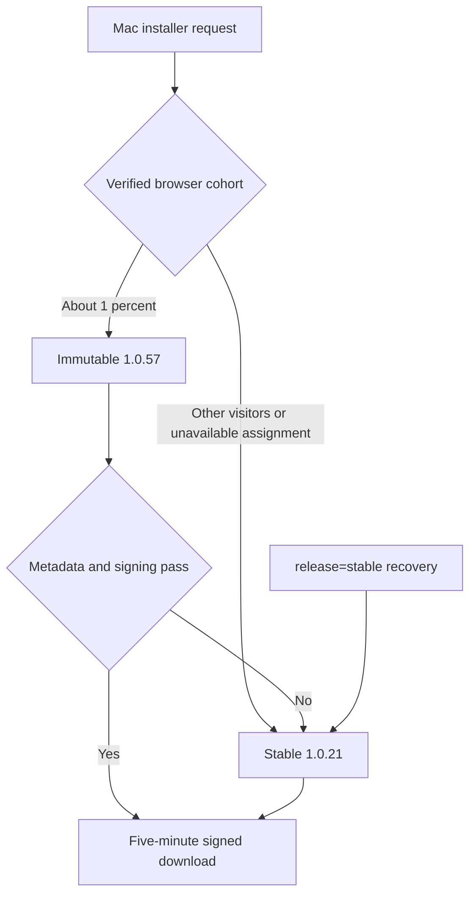

# Mac installer download pilot

## Approved scope

On October 29, 2026, Alex explicitly selected **1% of Mac installer downloads**
for the qualified standard 1.0.57 artifact. This supersedes the immediate
two-person private-link handoff, not the separate native-updater qualification.
This document describes the prepared implementation; activation requires the
same pushed main SHA in the Git-linked website and Linux API plus live readback.

The 1% is a probability over stable browser acquisition identities, not a hard
quota of one request in every hundred. Retries share the assignment while the
existing signed 30-day cookie remains valid. Different browsers, cleared or
expired cookies can be assigned again. No IP/device fingerprint is used.
The 1.0.57 qualification host was macOS 26.6.2 arm64 / Premiere 26.5.2; it does
not establish Intel or other host/OS compatibility. Generic browser user agents
cannot reliably distinguish Apple Silicon from Intel. This pilot includes Mac
installer traffic rather than claiming an architecture filter.

## Routing and recovery

`api/download.ts` selects the candidate only for the normal Mac stable handler.
The existing server-verified acquisition token and a versioned HMAC context
produce an independent deterministic cohort. The selector is bound to the
baseline version **and** hash; a later stable release disables this pilot until
deliberately rebound. No identity is added to download URLs or headers, and no
acquisition record is rewritten. Existing acquisition/referral writes still
occur only after a successful GET redirect. Assignment is not receipt, payment,
installation, or entitlement evidence.

GET persists a newly issued signed acquisition cookie. HEAD without a valid
cookie reports stable without assigning or recording a new identity. A
cookie-bearing HEAD reports the corresponding artifact. Responses vary by
Cookie and are private/no-cache (HEAD/304) or no-store (302). Version, hash and
cohort headers contain no identity. A query or unsigned header cannot force a
pilot assignment; `https://sidestream.tv/api/download?release=stable` always
selects stable for recovery, including an already-selected pilot browser.

Missing/invalid configuration, missing assignment authority or a changed
baseline selects stable. Candidate metadata/signing failures retry the existing
validated stable artifact; a broken stable path still returns its existing
failure instead of serving unverified bytes. Disabled/zero/invalid pilots are
absent from the artifact authorizer allowlist. The signed five-minute byte URLs
retain existing path, expiry and range-security checks.

The standard `/api/releases/latest` remains 1.0.21; paid Mac remains 1.0.17.
Windows, the independently published AE installer, checkout, account/license
controls and native Production updater HOLD are not rollout inputs. There is
no automatic expansion or native updater installation in this package.

## Immutable candidate

- Source: FlowState `4d26ee90e7879333e5a9726c9642eb9cf69504ab`.
- File: `Sidestream-1.0.57-Mac-Installer.dmg`, 227078245 bytes.
- SHA-256: `d8c91d5c6aa2ad3dd882926fd2a6112208ac39a7ec438ba77de5c2ba6f81aebe`.
- Server pathname: `sidestream/manual-beta/1.0.57/Sidestream-1.0.57-Mac-Installer.dmg`.
- Apple Accepted job: `3afd5cdd-8d09-4801-b849-441306f325f9`.
- Evidence: `sidestream-production-release-20261012/qualification/manual-beta-20261022-01`,
  including `repeat-20261026-01/controlled-media-and-relaunch.json`.

The standard installer passed signatures/stapling, expanded ownership/modes,
exact installed bytes, supported Restore, first/repeat installation, preserved
account/history data, real Premiere root/bridge/Pro verification, controlled
video/audio downloads/imports and normal relaunch on the recorded Mac. Two
audio-preview attempts failed with a format error while the subsequent WAV
download/import/Source playback checks passed. No clean independent tester or
generic paid-first/automatic-update qualification is inferred from these checks.
Issued installer bytes and version must never be modified or reused.

## Deployment and live proof

1. Upload through `scripts/upload-hetzner-artifact.mjs`; independently verify
   remote immutable size/hash before activating the config. Preserve 1.0.21.
2. Run targeted routing/delivery tests, `npm run build:hetzner-api`, entitlement
   and frontend build checks. Follow canonical main and Production-source rules.
3. Publish the exact main commit through Git integration, then deploy that same
   SHA to the Linux API as `sidestream-dev`; preserve existing runtime secrets
   and the independent AE and paid configuration. Require healthy same-SHA
   readback before declaring activation.
4. Verify stable and selected-cookie HEAD/GET, repeat assignment, stable
   recovery, Range and full candidate SHA through the public response. Operator
   fixtures must not create fake installs/health/entitlement or be counted as
   customer adoption. Recheck update/paid manifests and native updater HOLD.

## Observation and stop

`[sidestream mac download cohort]` logs only rollout id, selected version and
stable/pilot for successful GET redirects that are not recognized scanners.
These count requests, not unique people, completed transfers or installations.
Existing client telemetry provides actual 1.0.57 host/download/import activity;
exclude pre-pilot qualification sessions from customer adoption counts. Preserve
the distinction between missing telemetry and a product failure.

Hold at 1% until real installation/account/data/media/relaunch evidence is
reviewed. Stop for hash drift, installer failure, lost account/data, repeatable
host crashes or a material download/import regression. Do not automatically
advance to 10%. Set `enabled:false` or `percent:0` in this separate config and
deploy the same SHA to both execution surfaces to stop new pilot delivery;
leave immutable artifacts and customer data intact. A protected runtime override
`SIDESTREAM_MAC_DOWNLOAD_ROLLOUT_PATH` can point to an audited disabled copy for
emergency Linux rollback with a service restart, followed by canonical source
reconciliation. Never use the public stable manifest or native updater controls
as this pilot's kill switch.
