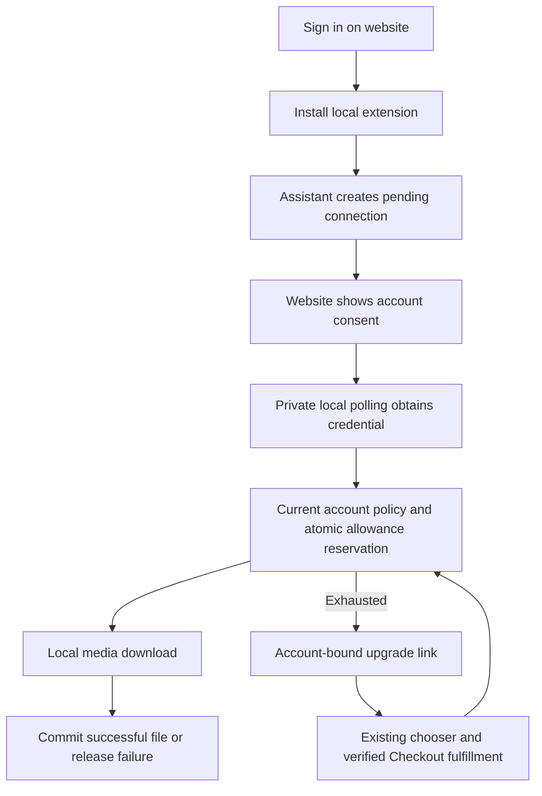

# Sidestream MCP account integration

This website owns browser sign-in, account-bound download allowance, current
paid capabilities, device admission, revocable assistant connections, and the
existing Checkout handoff. FlowState owns the local MCP tools, downloads, private
credential/job state, `.mcpb` packaging, and assistant skill. No media proxy or
new Stripe product is introduced here.

## Source map

| Area | Files |
| --- | --- |
| Connect/setup/consent and connection management | `mcp.html`, `src/mcp-connect.js`, account page link |
| MCP account API | `api/mcp/*`, `api/_lib/mcp.ts`, `api/_lib/mcp-security.ts` |
| Shared Free allowance and installation aliases | `api/_lib/download-credits.ts`, existing credit ledger |
| Canonical account/license/device policy | `api/_lib/account.ts`, `api/_lib/entitlement.ts`, existing device policy |
| Additive schema | `db/migrations/20261106120000_add_mcp_connections.sql` |
| Extension delivery | `api/download-mcp.ts`, `data/mcp-downloads.json`, `public/mcp-release.json` |
| API runtime | Existing auto-discovered Linux routes; no additional daemon |

## Browser and local-client flow



The browser URL carries only a public connection key. The private polling secret
never appears in a browser URL or assistant output. Approval uses an authenticated
website session, same-origin JSON POST and signed CSRF. OAuth preserves only
validated MCP continuations. Pending consent shows the signed-in account and a
Switch account link. Exact `prompt=select_account` bypasses the ordinary
already-signed-in shortcut so wrong-account users can recover without a loop.

Connections expire and can be revoked from `/mcp.html` or the local MCP tool.
Private credentials are hashed in the database. Revoked/expired credentials can
only settle a previously admitted job belonging to that exact connection; they
cannot read current account data or authorize new downloads. This avoids stranded
reservations after an interruption.

## API contract

All API responses are private/no-store and contain bounded public fields.
The integration routes require `SIDESTREAM_MCP_ENABLED=1`, existing credits
configuration, trusted license environment, and the additive migration.

| Route | Purpose |
| --- | --- |
| `POST /api/mcp/start` | Local device identity -> public connection ID, private poll token, browser URL, expiry/interval |
| `POST /api/mcp/token` | Private polling proof -> pending or locally delivered credential |
| `GET /api/mcp/authorize?connection=...` | Browser session, current consent state and CSRF |
| `POST /api/mcp/authorize` | Explicit approve/deny with CSRF |
| `POST /api/mcp/account` | Bearer-authenticated current plan and allowance |
| `POST /api/mcp/reserve` | UUID/fingerprint/format/source class/optional height -> atomic admission and server policy |
| `POST /api/mcp/finalize` | Idempotent commit or release of admitted UUID |
| `POST /api/mcp/revoke` | Revoke the current local connection |
| `GET /api/mcp/connections` | Browser-owned connection list and CSRF |
| `POST /api/mcp/connections` | Browser-owned revocation |
| `GET /api/mcp/upgrade?connection=...` | Account-bound activation continuation into existing chooser |

Free remains ten downloads total, up to 1080p. Pro remains $9.99/month with
unlimited 4K, without social downloads. Unlimited remains $39.99 one-time globally
with 4K/social, preserving regional offers and historical paid licenses. Prices
come from the canonical presentation helper. Both video and audio cost one Free
download. The model never controls account identity, wallet identity, price,
allowance or entitlement.

Binding an existing installation preserves spent and reserved usage; reconnects
and additional installations share the canonical account wallet. MCP/referral
ownership is checked in both directions. Bound wallet aliases remain authoritative
when MCP admission is disabled, so rollback cannot replenish an old wallet.

A Free upgrade is recognized by the next account/reserve request after normal
server fulfillment. Paid device limits and deactivation apply on every new job.
The current Checkout does not convert active Pro subscriptions to Unlimited;
Pro social requests return explicit account/support guidance instead of a false
purchase path or a second subscription. Upgrade mismatch/expiry/outage browser
responses contain a usable branded recovery page.

## Verification

```sh
npm run build:hetzner-api
node --test tests/mcp-postgres.test.mjs
node --test tests/mcp-connect.test.mjs tests/mcp-download-api.test.mjs tests/database-cutover-routing.test.mjs
npm run verify:checkout-contract
npm run test:entitlement
npm run test:credits
npm run typecheck
npm run build
```

The MCP database suite provisions disposable loopback PostgreSQL, applies the
real migrations and exercises the shipped routes/helpers. It covers pairing,
CSRF, private polling, exact ten/concurrent limits, refunds, cross-account
ownership, existing usage, referral compatibility, paid policy and device limits,
upgrade linkage, revoke/expiry settlement and account-switch continuation.
Frontend tests execute the shipped controller including setup, stale/expired
consent, duplicate submission, failed requests, recovery and disconnect.

## Release and rollback

1. Finish local checks and review the exact MCP bundle generated in FlowState.
2. Apply the additive migration through the existing migration process.
3. Deploy synchronized canonical main to both the Website frontend and owning
   Linux API through their established release contracts.
4. Set `SIDESTREAM_MCP_ENABLED=1` only after database/API compatibility is verified.
   Use the existing sufficiently long license hash secret or the dedicated
   `SIDESTREAM_MCP_TOKEN_SECRET`; never expose either to the client or logs.
5. Upload the immutable extension package through approved artifact storage. Pin
   its exact version, filename, private pathname, size and SHA-256 in
   `data/mcp-downloads.json`. Verify `/api/download-mcp?release=<id>` delivers those
   exact bytes, then set `public/mcp-release.json` available with that URL.
6. Qualify website Google sign-in, the actual Claude Desktop installation and
   connection, one real permitted download, exhausted allowance, and provider
   sandbox payment/fulfillment. Local fixtures do not prove these external steps.

The release manifest deliberately starts unavailable. Never expose a dead install
button or claim public/directory availability from a local package alone. The
artifact signer is an exact database-free Vercel route, like the CLI signer;
account and MCP API routes keep the existing protected Linux database boundary.

Disable new MCP admission with the flag for rollback. Preserve the additive
schema, wallet bindings, ledger and existing purchases. Do not reset quotas,
remove aliases, revoke unrelated panel access or delete customer records.
