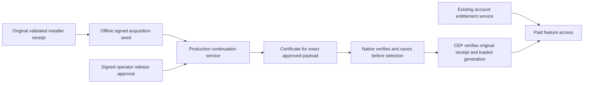

# Production Mac update service

Website owns the production policy, immutable delivery and paid-continuation
authority. FlowState owns the Mac companion, signed payloads, receipt validator
and installers. Historical local qualification remains in
[full-app-updater.md](full-app-updater.md).

The authority is `https://downloads.sidestream.tv/updates/macos`, behind the
existing downloads TLS host. `sidestream-updater.service` runs as its own
unprivileged user on `127.0.0.1:3103`; it does not share the account API process
or require database credentials. Initial deployment is held with an empty
catalog. Deployment of this service does not publish a new installer or change
`/api/download`, `/api/releases/latest`, paid-acquisition fulfillment or Windows.

## Source map and routes

| Source | Responsibility |
| --- | --- |
| `scripts/production-update-service.mjs` | Verified artifact catalog, bounded HTTP delivery, durable policy counter, atomic operator state, CLI administration |
| `scripts/production-update-protocol.mjs` | Production scopes, signature and manifest validation, paid-continuation issuance |
| `scripts/production-update-operator.mjs` | Offline signing of exact control requests against a current snapshot |
| `scripts/provision-production-updater.mjs` | Explicit one-time creation of separate production keys outside the repository |
| `scripts/user-update-test-control.mjs` | Shared v2 cohorts, exact rollback/revocation and range rules; private scope remains the default |
| `scripts/user-update-test-operator.mjs` | Shared five-minute operator signatures, compare-and-swap and replay validation; private scope remains the default |
| `ops/app-updates/sidestream-updater.service` | Dedicated account, read-only code/artifacts, private credentials/state, process lock and restart policy |
| `ops/nginx/downloads.sidestream.tv.conf` | TLS path-prefix proxy, body/request limits, no updater access logs |

All routes below are relative to the authority prefix. There is no HTTP control
mutation endpoint and no redirect is required or accepted by the client.

| Route | Contract |
| --- | --- |
| `GET /health` | Source SHA, production scope, held state, release count, control revision; no customer data |
| `GET /policy?client=<64-hex>` | Ed25519 policy envelope, 60-second lease, monotonically persisted revision, independent download/activation/companion cohorts |
| `GET /delivery?client=<64-hex>&id=<id>&sha256=<hash>` | Signed exact-target delivery lease, with a 60-second HMAC route |
| `GET /releases/<id>/manifest.json` | Offline-release-key-signed immutable manifest; revoked targets are denied |
| `GET /releases/<id>/payload.bin?expires=...&mac=...` | Exact matching `If-Range` ETag and `Range: bytes=start-end` required; at most 4 MiB per request |
| `POST /continuation` | At most 64 KiB JSON: `{client, prior:{payload,signature}, target:{id,sha256,manifestSha256,version}}`; returns a signed continuation envelope |

The `client` is the existing random updater identifier, not an account, email,
device serial or installation identity. Certificate/acquisition material stays
in the POST body, never a URL, access log or telemetry event. Nginx uses a
separate updater rate zone (20 requests/second, burst 40, six connections per IP).
Requests cannot supply their own trusted public key or source artifact path.

## Paid continuity and signing roles



Production releases/policy/delivery use scope
`sidestream-user-release-production-1`; paid certificates use
`sidestream-paid-update-production-1`. Test/private certificates are rejected.
There are four distinct Ed25519 keys and a separate 32-byte delivery HMAC key:

- **Release:** offline; signs immutable manifests and the initial acquisition
  seed only after FlowState's unchanged receipt/installation validator passes.
- **Policy:** online; signs short-lived update and delivery leases.
- **Continuation:** online; extends a previously signed acquisition to an exact
  approved paid-onboarding CEP target. It cannot mint an acquisition from raw
  receipt fields. It is not the release key.
- **Operator:** offline; signs rollout/hold/revoke/rollback changes, with current
  control revision/digest, nonce and five-minute expiry. It cannot be a service key.

The service accepts a valid seed signed by the pinned release key, or a previous
certificate signed by the pinned continuation key. The full chain, scope and
acquisition fields are validated. The requested final target must match the
verified catalog's ID, archive hash, manifest hash and version, be a paid CEP
release, be in this client's current download or activation cohort, and not be
revoked. The response preserves the exact original acquisition and re-anchors
one link from the original receipt to that target. This prevents exhaustion of
the 32-link validation limit and permits separately policy-approved rollback.

Certificates deliberately have no clock expiry: the current signed policy owns
selection freshness, hold, revoke and exact rollback. An old certificate cannot
authorize selecting a release. The native updater saves a verified certificate
before selection, then obtains fresh policy. Failure retains the working
generation. The CEP validator still checks the actual original receipt bytes,
stable installation identity, pinned signer and loaded generation. Neither this
service nor a certificate creates an account entitlement or changes payment,
license, trial, credits or acquisition records.

## Provisioning and deployment

Provisioning is explicit, never part of service startup:

```sh
node scripts/provision-production-updater.mjs --out /absolute/new/private/key-directory
```

The new directory must be outside the repository. Keep `release.pem` and
`operator.pem` offline with a protected backup. Copy only `policy.pem`,
`continuation.pem`, and `ticket.key` to root-owned mode-0600 files under
`/etc/sidestream/app-updates/`. The unit exposes them as systemd credentials to
the service. Never copy `release.pem` to that directory. Public `trust.json`,
`operators.json` and the initial empty `catalog.json` are root-owned under
`/srv/sidestream-updates/`. Private keys must match the public pins at startup.
Key rotation requires an intentionally qualified client trust update; replacing
keys or state as a way to recover a failed signature is not supported.

Deploy only a clean, pushed Website `origin/main` commit, after
`npm run verify:production-source`, `npm run test:entitlement`, `npm run build`
and `npm run test:production-updater`. Transfer that commit's scripts and ops
files to a root-owned immutable
`/srv/sidestream-updates/releases/<full-sha>/`, then point `current` there.
`/etc/sidestream/updater-source.env` contains only
`SIDESTREAM_UPDATER_SOURCE_SHA=<full-sha>`. Keep the previous code directory,
unit/config copies and state backup before replacing an existing deployment.
The account API service need not restart for an updater-only deployment.

Create system account `sidestream-updater` without login, mode-0700
`/var/lib/sidestream-updater` owned by that user, and root-owned mode-0755
`/srv/sidestream-updates/artifacts`. The state directory is persistent;
`/run/sidestream-updater/service.lock` is a separate kernel-held process lock.

Initial held state is explicit and refuses an existing/nonempty state or catalog:

```sh
runuser -u sidestream-updater -- node /srv/sidestream-updates/current/scripts/production-update-service.mjs \
  --initialize --state /var/lib/sidestream-updater \
  --trust /srv/sidestream-updates/trust.json \
  --catalog /srv/sidestream-updates/catalog.json \
  --artifacts /srv/sidestream-updates/artifacts
```

Install the unit, source-SHA file, and the reviewed new Nginx route/rate zones.
Run `systemd-analyze verify`, `nginx -t`, start/enable only
`sidestream-updater.service`, and reload Nginx. Verify loopback and public health
show the exact deployed SHA and held state; cryptographically verify a real
public policy response using the provisioned `policyKey`. Restart the unit and
verify revisions increase across restart. Invalid continuation requests must
fail closed. Also verify canonical `sidestream.tv/version.json` reaches the
Git-linked pushed SHA and `/api/checkout/start` still redirects correctly.

## Publishing artifacts and changing control

Catalog structure remains `{scope,releases:{<id>:{target,manifest,payload}}}`;
`target` is `{id,sha256,manifestSha256,bytes}`. Paths must be absolute beneath
the artifact root, real regular files without symlinks or writable group/other
bits, root-owned in the deployed service. Upload to a new immutable release
directory; never replace bytes under an existing ID/hash. Startup verifies full
archive/manifest hashes, offline signatures, production scope, inventory and
signed onboarding metadata. Catalog metadata cannot override signed metadata.
Run `--verify` with the same state/trust/catalog/artifact arguments before a
service restart. Retain every target referenced by the current control and
needed for rollback. Replacing a catalog requires restart, not an HTTP write.

Control JSON uses the existing `sidestream.user-control.v2` shape. Download and
activation approvals are independent; percentages alone cannot change hashes.
To apply a reviewed control:

1. Run `--snapshot` on the host as `sidestream-updater` with the same four path
   arguments; save the revision/digest locally as a private JSON file.
2. Locally run `node scripts/production-update-operator.mjs --key <offline-operator.pem>
   --snapshot <snapshot.json> --control <reviewed-control.json> --out <new-request.json>`.
3. Transfer the signed request through authenticated SSH into a private same-user
   regular file. Within five minutes, run `--apply --request <request.json>
   --operators /srv/sidestream-updates/operators.json` as `sidestream-updater`,
   with the same state/trust/catalog/artifact arguments. No private service keys
   are needed for administrative CLI modes.
4. Read back snapshot and signed policy. A hold sets both download/activate to
   null (and companion choices null); revocation additionally denies artifact
   access. Previously issued payload tickets may remain valid for 60 seconds
   after a hold, but cannot authorize client activation.

`control.json` atomically stores the current control and audit history (operator,
nonce, approval digest, timestamp and revision). Stale/replayed approvals fail.
Only one operator write can hold the kernel lock on `operator.lock`. The CLI uses
Linux `flock --no-fork`: process death releases the lock; the persistent lock file
is harmless and must never be deleted/replaced during operation. The internal
`--apply-locked` mode belongs only to the flock wrapper. At 1,024 history entries,
archive the protected audit under controlled maintenance, preserve current
revision and nonce history policy, and do not reset state casually.

`counter.json` is fsynced before each signed policy/lease is emitted. Do not
restore an old counter or reset it to zero for clients already in service.
Back up the state with the service stopped for a consistent snapshot; before
any recovery, preserve or advance the latest issued counter. A missing/corrupt
counter fails startup. Code rollback should reuse current trust, artifacts and
state; schema rollback must be reviewed separately. Check journal errors and
`/health`; no acquisition bodies are logged. Nginx updater access and error logs
are suppressed because upstream/rate-limit errors can otherwise include signed
request URLs; other downloads-host logging is unchanged.

## Verification and release boundary

`npm run test:production-updater` exercises actual HTTP delivery, third/future
release signing, 40 successive re-anchors, wrong scopes/keys/targets, forged
proofs, denied cohorts, revocation, expiry, exact ranges, tampered artifacts,
signed control CLI, CAS/replay and restart persistence. FlowState independently
tests native signature/cache/selection behavior and the unchanged receipt
validator; both staged payload builds remain mandatory there.

Service availability and passing tests do not qualify an installer. Before
enabling customers, build/notarize/staple a production-scope companion and
installer pinned to these keys, prove the installed future paid update and
rollback in Premiere, upload immutable qualified artifacts, and separately
approve the exact rollout/public installer. Keep the service held until those
gates have evidence.
