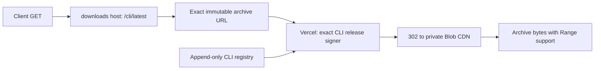

# Public Sidestream CLI download

The standalone CLI is delivered separately from the Adobe installers. The current archive supports macOS Apple silicon and Intel, and requires an existing Node.js 18+ installation. It contains the shared download engine and Mac helper binaries; it does not require Premiere or a source checkout.

Public entrypoints:

- `https://downloads.sidestream.tv/cli/latest` redirects to the current immutable archive URL.
- `https://downloads.sidestream.tv/cli/latest.json` returns its version, platform requirements, size, SHA-256, and immutable download URL.
- Each exact versioned archive URL redirects to `https://sidestream.tv/api/download-cli?release=<release-id>`. `GET` validates the pinned Blob pathname and size, then issues a five-minute GET URL so Blob's CDN serves the bytes directly. `HEAD` returns pinned size, filename, version, and SHA-256 without signing or transferring bytes.



`data/cli-release.json` selects latest and pins platform/runtime requirements and the shared-source content digest. Append-only `data/cli-downloads.json` retains every published release's filename, pathname, size, and SHA-256, so advancing latest cannot retarget old immutable URLs. Do not edit or remove a published registry entry. New bytes require a new release ID and filename.

`api/download-cli.ts` is database-free and never imports account, acquisition, payment, or installer-provider code. Only the exact `/api/download-cli` path bypasses Linux API routing in `middleware.ts`; incoming origin/forwarding headers are removed. The signer accepts exactly one `release` parameter, rejects arbitrary pathnames and duplicate/extra parameters, and returns generic `503` errors without provider details. The registry is explicitly included in this Vercel function through `vercel.json`. There is no function byte proxy and no change to the global installer provider.

Run `node --test tests/cli-download-api.test.mjs tests/cli-download-route.test.mjs tests/database-cutover-routing.test.mjs` to verify signing scope, immutable release continuity, and the private-storage boundary.

FlowState owns the shared CLI source, archive builder, bundled dependencies, and standalone smoke tests. This Website repository owns the registry, signer, download-host configuration, and publication. A public CLI archive is not an Adobe installer release or a change to paid entitlement.

The Nginx configuration in `ops/nginx/downloads.sidestream.tv.conf` retains only exact CLI routes. Never add a public alias for `/srv/sidestream/artifacts`, a wildcard CLI directory, or change `/v1/` and `/__sidestream_artifacts/` to publish the CLI. Ordinary and paid installer storage remains behind its existing signed allowlist. The current CLI metadata file remains a root-owned exact static alias; archive bytes use the CDN redirect.

## One-command install

The Website serves `public/install.sh` unchanged at
`https://sidestream.tv/install.sh`. Vite copies it to `dist/install.sh`; the exact
Vercel header rule serves a plain-text download without caching. It does not
enter API middleware or require a download-host configuration change.

Paste this single line into Terminal on the destination Mac:

```sh
curl -fL --retry 3 https://sidestream.tv/install.sh -o ~/Downloads/install-sidestream.sh && /bin/bash ~/Downloads/install-sidestream.sh
```

The command finishes downloading the script before running it with macOS Bash.
After installation, open a new Terminal tab and run `sidestream --help`.
URLs passed to the CLI should be quoted.

The bootstrap supports Intel and Apple Silicon on macOS 12+. It reuses a native
working Node 22+ installation, or privately installs an official Node runtime:
Node 24 on macOS 13.5+, Node 22 on older compatible Macs. It verifies Node's
versioned archive against the official SHA-256 manifest. It pins CLI release
`1.0.21-86876e22b6c162af` and its archive SHA-256; update both together after
qualifying a newer CLI. The CLI's own minimum Node requirement remains 18.

The bundle includes Python, yt-dlp, FFmpeg, FFprobe, and Deno. The installer tests
every runtime and the CLI before switching `~/.local/bin/sidestream`; an existing
launcher is backed up beside the new installation. Installed files live below
`~/.local/share/sidestream-cli`. It adds the command directory to zsh and the
existing Bash login profile, without replacing prior profile contents. No
Homebrew, Xcode, sudo, npm install, or Adobe app is required. Browser/Keychain
permissions and a signed-in source session remain separate from installation.

For isolated verification, pass an absolute destination directory. This skips
profile edits and creates `<destination>/bin/sidestream`:

```sh
/bin/bash -n public/install.sh
/bin/bash public/install.sh /absolute/scratch/install-check
# To exercise the missing-Node branch, use only macOS system tools on PATH:
env PATH=/usr/bin:/bin:/usr/sbin:/sbin /bin/bash public/install.sh /absolute/scratch/fresh-check
```

For publication, run the repository release checks, compare
`public/install.sh` with `dist/install.sh`, commit/push canonical `main`, and
verify the live script bytes and the canonical version SHA. The hosted bootstrap
does not change the CLI archive, release registry, Adobe installers, or updater.

## Publication

1. Build and smoke-test the CLI archive from FlowState. Keep filenames and storage pathnames immutable, and retain the SHA-256 and byte count. Release IDs must distinguish changed bytes even when the Adobe package version is unchanged.
2. Retain an immutable origin copy of the archive and release JSON using the existing artifact uploader:

   ```sh
   node scripts/upload-hetzner-artifact.mjs --artifact /absolute/archive.tar.gz --pathname sidestream/cli/RELEASE/archive.tar.gz
   node scripts/upload-hetzner-artifact.mjs --artifact /absolute/release.json --pathname sidestream/cli/RELEASE/release.json
   ```

   The uploader uses `root@2.29.9.121`, `~/.ssh/sidestream_hetzner_ed25519`, and `/srv/sidestream/website-backend/scripts/finalize-hetzner-artifact.mjs`. It verifies size/SHA, refuses different bytes at an existing pathname, and publishes root-owned `0444` files. Do not use the Adobe installer manifest publisher for CLI releases.
3. Mirror the same verified archive to the existing private `sidestream-release-105` Blob store at the identical pathname. Use the protected existing `BLOB_READ_WRITE_TOKEN` or Vercel OIDC, `put()` with `access: "private"`, `addRandomSuffix: false`, `allowOverwrite: false`, and multipart upload. Do not change the store's access mode or existing project credentials. If the pathname already exists, verify it instead of overwriting. Require a complete Blob readback with the same byte count and SHA-256 before publication. Keep all tokens and signed URLs out of source and logs. A full download transfers 222,415,181 bytes for the initial release; include expected download volume when monitoring Blob usage.
4. Add the new immutable entry to `data/cli-downloads.json`, update latest metadata, and add its exact Nginx archive redirect to the release signer. Keep all previous registry entries and exact archive routes. `/cli/latest` and `/cli/latest.json` must select the same release.
5. Run the focused checks and Website `AGENTS.md` publication checks. Commit on synchronized `main`, push `main:main`, wait for canonical `/version.json` to report that SHA, and verify the ordinary Checkout redirect. Verify the new live signing API returns the correct pinned `HEAD`, a `GET` redirect to Blob, and `404`/`405` for invalid releases/methods before activating the Nginx redirect. No Linux Website service or database restart is needed: this exact signer runs on Vercel.
6. Compare live Nginx with the tracked pre-change source and retain a root-only timestamped rollback copy. Install reviewed configuration to `/etc/nginx/sites-available/downloads.sidestream.tv` with mode `0644`, run `nginx -t`, then `systemctl reload nginx`. If validation fails, restore the previous file without reloading.
7. From an external client, verify latest redirect, JSON, archive `HEAD`, one-byte `206`, complete download size/SHA-256, transfer time, and standalone execution from the downloaded archive. A server-local download does not qualify client performance. Confirm unsupported methods, unknown CLI paths, and direct internal installer paths return no bytes. Check the normal installer `HEAD` and signed redirect still work.

For a CDN outage, restore the previously reviewed exact origin-file Nginx alias from the protected rollback copy, pass `nginx -t`, then reload. The preserved origin archive has identical bytes but may transfer more slowly on distant networks. Keep both immutable copies and their metadata; never overwrite or delete them to roll back delivery.
