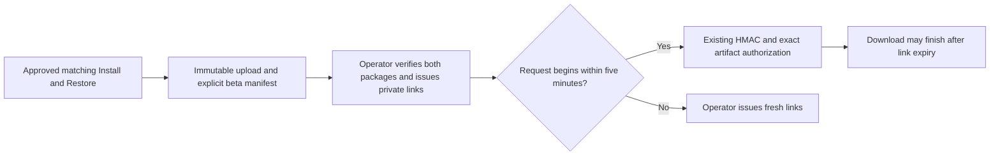

# Native updater beta installer delivery

This prepared manifest binds the finalized standard Mac 1.0.62 Install and Restore
pair, candidate `standard-beta-20261106-01`, native 0.4.17/build 48 from source
`e462dc3a78779f12a8b1baa458c06313bb2c2988`. Both packages bind the same sealed seed
and distinct final package hashes. Apple acceptance, independent expanded artifact
QA, immutable remote hashes, canonical publication and intended-response proof
must all be retained before claiming delivery is qualified.

This replaces the prior 1.0.60 pair, whose delivered bytes and Apple trust passed
but whose native build 43 Recovery service failed before startup because its
signing identity differed from the previously registered service. The replacement
preserves the prior service signing identity. Actual installed service startup,
repeat Install, matching Restore and current-candidate updater qualification are
separate gates. Retain the old immutable artifacts and failure evidence; do not
issue new links for that family.

The existing `/v1/` HMAC authorizer serves these PKGs only when their exact pair
is explicitly enabled. Public/paid manifests, the manual Mac rollout, update
notices, public CTAs and native updater controls are independent. This adds no
customer API or automatic renewal endpoint. Installer possession grants no paid
entitlement or native update eligibility.



## Source and publication

- `api/_lib/updater-beta-installers.ts` validates one candidate and derives exact
  PKG names/pathnames; arbitrary filenames, URLs and extra artifacts are refused.
- `api/_lib/installer-delivery.ts` adds the valid pair to its existing allowlist.
  Disabled/malformed beta configuration excludes only beta. PKGs use
  `application/octet-stream` with the existing attachment filename and Range flow.
- `scripts/issue-updater-beta-downloads.mjs` runs locally on the deployed Website
  host. It loads the existing protected runtime signing secret, checks immutable
  ownership/permissions, hashes both files, and creates a new mode-0600 link file.
  It does not print bearer URLs, send messages, alter configuration or update offers.
  There is no manifest-path override: the issuer and `/v1/` authorizer use the
  compiled canonical manifest and reject every path outside its current allowlist.

Prepare the fresh FlowState candidate with source and Apple trust proof. These
steps first support internal delivered-byte qualification; customer handoff still
requires every current-candidate gate, including repeat Install, matching Restore
and real Premiere preservation:

1. Record the fresh immutable candidate ID, version, full native source commit,
   shared seed ZIP SHA-256 and both finalized PKG hashes/sizes. Preserve Apple
   Accepted/stapled trust proof. Do not reuse previously issued identifiers.
2. Upload each verified PKG using `release:upload-hetzner`, with pathname
   `sidestream/updater-beta/<candidate-id>/Sidestream-<version>-Mac-Install.pkg`
   or the matching `-Restore.pkg`. The existing finalizer enforces exact bytes
   and refuses overwriting an immutable pathname.
3. Replace the disabled manifest with `schemaVersion: 1`, `enabled: true`, and
   `candidate` containing exactly `id`, `version`, `sourceSha`, `seedSha256`,
   `install` and `restore`. Each package record contains only `sha256` and
   `sizeBytes`. Both records are required and must have distinct hashes.
4. Run the tests below, entitlement and builds. Integrate the reviewed change
   onto synchronized clean `main`; publish only the pushed canonical commit.
   Deploy the same Website API/artifact-authorizer source, including compiled
   `.server-dist/data/updater-beta-installers.json`. Follow the
   [existing deployment and artifact contract](installer-delivery-cutover.md).
   The separate native updater service does not need a restart or offer change.
5. Issue links into an existing operator-owned mode-0700 directory on the host:

   ```sh
   cd /srv/sidestream/website-backend
   sudo node scripts/issue-updater-beta-downloads.mjs --out /root/private-beta/new-links.json
   ```

6. Before tester handoff, verify HEAD metadata, one-byte Range, both complete
   served PKG hashes and Apple trust from the intended response. Confirm missing,
   altered, expired and unknown-path signatures return no bytes. Install that
   exact downloaded response through normal macOS Installer authorization and
   verify fresh real Premiere health/account/history/settings. Publishing bytes
   alone does not close this delivery/install gate.

Pace all verification requests through one queue at least 5.5 seconds apart.
The existing `/v1/` Nginx limit is 12 requests/minute with burst 6; excess requests
can return 503 before reaching signature authorization. Preserve the production
limit and record its status separately from an authorization rejection.

## Expiry, renewal and recovery

Each link authorizes new GET/HEAD/Range requests for five minutes. An already
admitted full download can finish after expiry. A browser resume that starts a
new request after expiry receives 404; it does not obtain a fresh authorization.
Issue a new pair by rerunning the operator with a new output filename, and hand
off the fresh link privately. Depending on the download client, the tester may
need to restart the file download. There is no scheduled renewal, public renewal
URL or longer-lived token hidden behind these links. This is suitable for a
coordinated limited beta, not an unattended email/download flow.

Provide the matching Restore file with Install and keep a local copy. Running
Restore uses normal macOS authorization and returns that seed's original
installation baseline; it does not erase account history or revoke entitlement.
Shared-system migration still needs the explicit shared-user decision documented
by FlowState. The beta is scoped to its qualified platform and host.

To stop new beta downloads, deploy `enabled: false, candidate: null`. Existing
signed beta links then fail the current allowlist even before their expiry;
already admitted downloads may finish. Retain immutable artifacts and evidence.
This action changes neither existing customer installers nor native HOLD/control.

## Checks

```sh
node --test tests/updater-beta-installers.test.mjs tests/installer-delivery.test.mjs tests/download.test.mjs tests/after-effects-release.test.mjs tests/release-contract.test.mjs
npm run build:hetzner-api
npm run test:entitlement
npm run build
git diff --check
```
